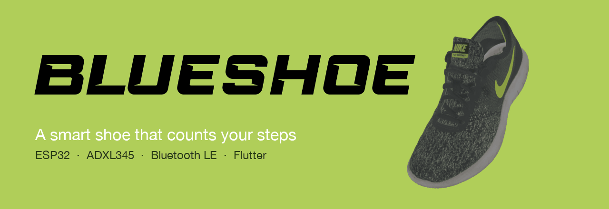
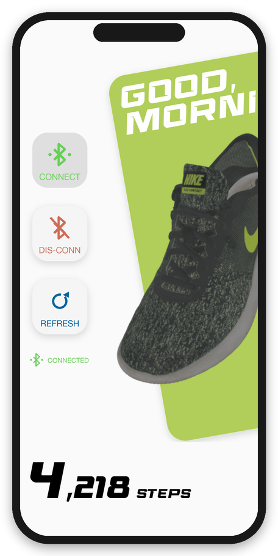
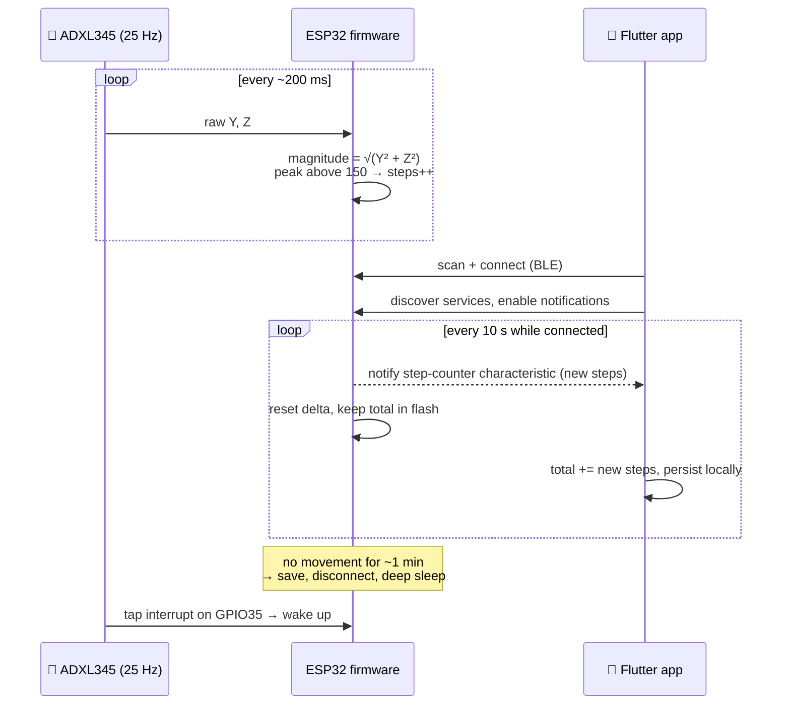
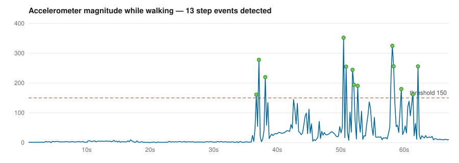

<p align="center">
  
</p>

<p align="center">
  
  
  
  
</p>

**BlueShoe** is a DIY smart shoe. An ESP32 with an ADXL345 accelerometer rides along on your shoe, counts every step, and keeps the count even when the battery-saving deep sleep kicks in. The Flutter companion app connects over Bluetooth Low Energy and syncs the steps to your phone, where they're shown as a big step counter.

It was built end to end in May–June 2022: firmware, BLE protocol, mobile app and the 3D-rendered shoe animation.

<p align="center">
  
  <br>
  <sub>Home screen, recreated from the app's own layout code (<code>home.dart</code>) and assets.</sub>
</p>

## ✨ Features

**On the shoe (ESP32 firmware)**
- 👣 **Step detection** from the accelerometer's Y/Z axes, with calibration on boot to cancel out how the board is mounted.
- 💾 **Never loses a step.** The counter is saved to flash (NVS `Preferences`) every 3 seconds and right before sleeping.
- 🔋 **Deep sleep** after about a minute without movement. The BLE link is closed, the ADXL345 goes to low power, and the ESP32 sleeps.
- 👆 **Tap to wake.** The ADXL345's tap interrupt is wired to `GPIO35` and wakes the ESP32 up again.
- 📡 **BLE pedometer service.** While a phone is connected, new steps are pushed every 10 seconds as notifications.

**On the phone (Flutter app)**
- 🔍 Scan for nearby devices and pick your shoe from a bottom sheet.
- 🔄 Connect, sync and disconnect buttons that switch on and off with the connection state.
- 🔢 Animated flip counter in a racing typeface. Steps are stored on the device with `get_storage`, so the total survives restarts.
- 👟 Loading screen with a spinning 3D shoe: a 24-frame image sequence rendered from a 3D-scanned sneaker in Blender.

## 🧠 How it works



### Step detection

The firmware takes the magnitude of the calibrated Y and Z acceleration. A step counts whenever that magnitude has just peaked (the previous sample is bigger than the current one) above a threshold of `150`. Here is the rule run against a real walking recording from [`Arduino/Plotter`](Arduino/Plotter):

<p align="center">
  
</p>

The raw recordings (`x_z_moving*.csv`, `x_z_steady.csv`) and the Plotly script used to tune the threshold (`drawplot.py`) are in that folder too.

### Bluetooth LE protocol

The shoe advertises as **`BlueTest`** and exposes a custom GATT layout on 16-bit UUIDs (base `0000xxxx-0000-1000-8000-00805f9b34fb`):

| Service | UUID | Characteristic | UUID | Properties | Payload |
|---|---|---|---|---|---|
| Physical activity monitor | `0x0002` | Step counter | `0x0003` | read, notify | `uint16`, big-endian, steps since last sync |
| Battery *(reserved)* | `0x0001` | Battery level | `0x0000` | — | — |
| LED controller *(reserved)* | `0x0004` | LED | `0x0005` | — | — |

The battery and LED services are declared on both sides ([`def_bleuuid.h`](Arduino/blueshoe/blueshoe/include/def_bleuuid.h), [`uuidbank.dart`](Flutter/blueshoe/lib/constants/uuidbank.dart)) but only the pedometer service is implemented in the firmware.

## 🔌 Hardware

| Part | Notes |
|---|---|
| ESP32 DevKit (`esp32dev`) | Built-in LED on `GPIO2` blinks on boot and turns off before deep sleep |
| ADXL345 accelerometer | I²C at `0x53` (ESP32 default pins: SDA `GPIO21`, SCL `GPIO22`), ±2 g, 25 Hz |
| ADXL345 `INT1` → `GPIO35` | Tap interrupt that wakes the ESP32 from deep sleep |

## 📁 Repository layout

```
Arduino/
├── blueshoe/blueshoe/     PlatformIO firmware (src/main.cpp, include/*.h)
├── Plotter/               accelerometer recordings + plotting script
└── Documentations/        ADXL345 datasheet, BLE / GATT specs
Flutter/
├── blueshoe/              Flutter app (GetX, flutter_blue)
├── 3D Models/             3D shoe model + rendered animation frames (.blend files via Git LFS)
└── Icons/                 UI icons
*.pdf                      research papers on step counting
docs/                      images used in this README
```

## 🚀 Getting started

> BlueShoe is a 2022 prototype. The app targets Dart 2.17 and uses `flutter_blue` 0.8, which is no longer maintained. To build it today you may need an older Flutter SDK, or to migrate to `flutter_blue_plus`.

**Firmware** ([PlatformIO](https://platformio.org/)):

```bash
cd Arduino/blueshoe/blueshoe
# set upload_port in platformio.ini to your board's serial port (it's COM3 by default)
pio run -t upload
pio device monitor        # 115200 baud
```

**App**:

```bash
cd Flutter/blueshoe
flutter pub get
flutter run               # on a real phone with Bluetooth enabled
```

Tap **CONNECT**, choose **BlueTest** from the list, and start walking.

**3D assets**: the Blender files are stored with Git LFS. Run `git lfs install` before cloning, or `git lfs pull` afterwards, if you need them.

## 📚 Research

The step-detection approach was informed by the papers at the repo root, including *Step Counting: A Review of Measurement Considerations and Health-Related Applications*.

## 🙏 Credits

- 3D shoe: this work is based on ["Nike Flex Contact Shoe 3D Scan (WithTexture)"](https://sketchfab.com/3d-models/nike-flex-contact-shoe-3d-scan-withtexture-ce4d5dc044484f5a9ecd9747e9be2d87) by [Arkify](https://sketchfab.com/arkify), licensed under [CC-BY-4.0](http://creativecommons.org/licenses/by/4.0/).
- UI icons by [Icons8](https://icons8.com).
- Firmware libraries: [Time](https://github.com/PaulStoffregen/Time) and [TimeAlarms](https://github.com/PaulStoffregen/TimeAlarms) by Paul Stoffregen, and [ADXL345](https://github.com/jakalada/Arduino-ADXL345) by jakalada.
